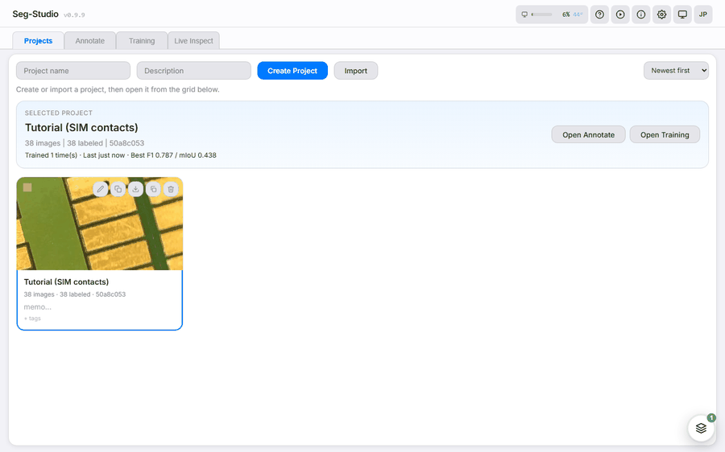
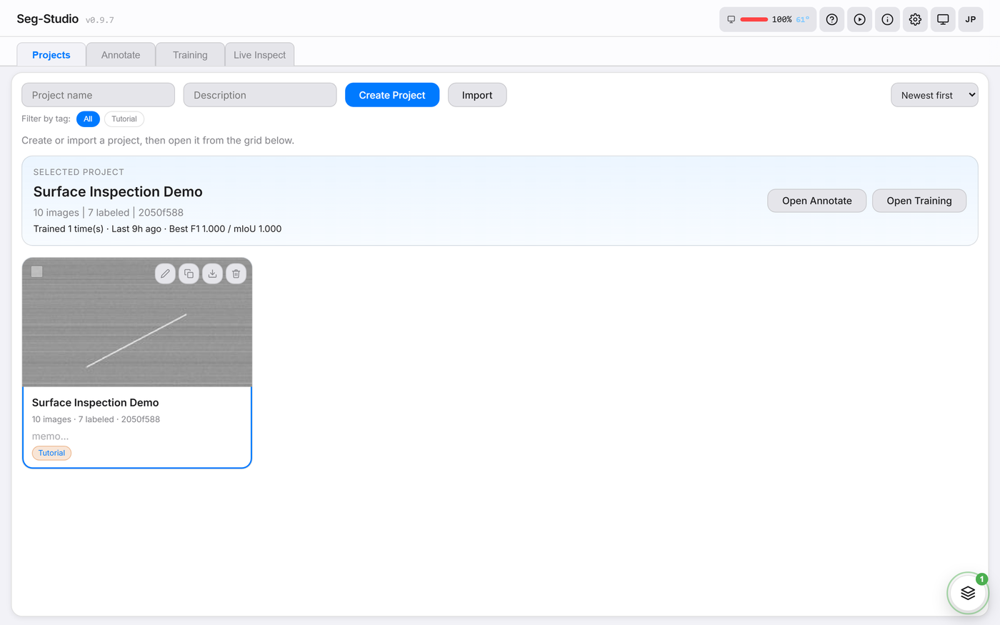
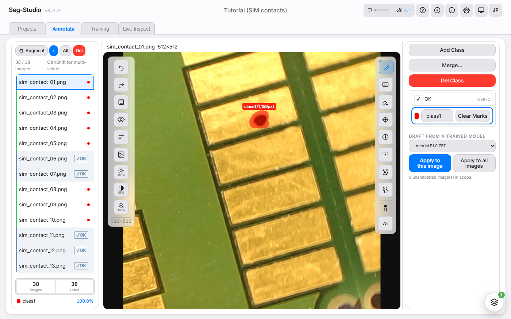
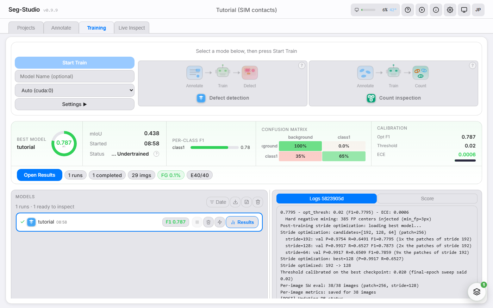
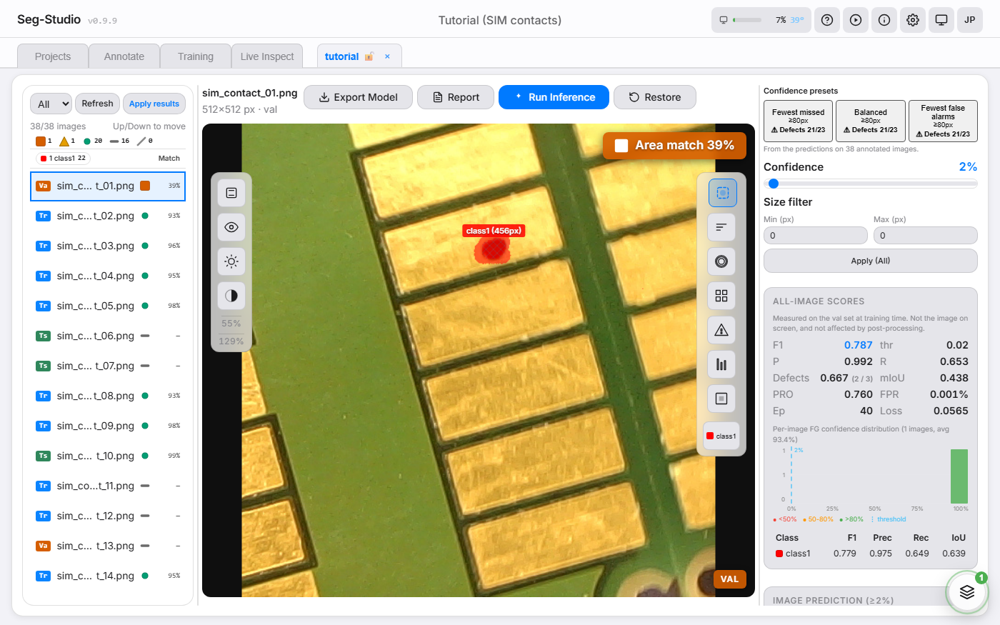

<div align="center">

# Seg-Studio

**Build an AI that marks exactly where things are in your images -- on your own PC.**


[Try it](#try-it) | [What it does](#what-it-does) | [Japanese](README.ja.md)

</div>

<p align="center">
  
</p>

<p align="center"><sub>44 seconds, end to end: label with a click &rarr; train &rarr; check the results &rarr; export</sub></p>

Seg-Studio is an app for building an AI model that finds things in images --
scratches, stains, parts, cells -- down to the pixel, without writing code.
You mark up some images, train, and check the results, all in one window.

- **Your data stays with you.** Everything runs on your own machine; no cloud account is needed
- **Free to use.** Open source (Apache-2.0), commercial use included
- **Runs in your browser.** Starting it opens the app in a browser tab, in English or Japanese

---

## What it does

| | |
|---|---|
| 🖌️ **Label** | Paint the areas you want found. A click-to-outline AI (SAM) can trace a shape for you |
| 🧠 **Train** | Turn your painted images into an AI model. Settings are chosen automatically, so you press a button and wait; progress and the training log update as it runs |
| 🔍 **Check** | Run the model on new images and see what it found and what it missed. Save a report as PDF or Excel |
| 🔢 **Count** | Count objects one by one, even when they touch or overlap -- using the masks you already painted, with no extra labelling |
| 📦 **Export** | Save the model as ONNX, CoreML and more, to use it in other software or on an iPhone / iPad |

Every feature is listed in the [Feature Catalog](docs/catalog.md).

## Screenshots

<table>
  <tr>
    <td align="center">
      <br />
      <b>Projects</b> -- Manage datasets and runs
    </td>
    <td align="center">
      <br />
      <b>Annotate</b> -- Brush, SAM click, and more
    </td>
  </tr>
  <tr>
    <td align="center">
      <br />
      <b>Training</b> -- Live progress, scores and training log
    </td>
    <td align="center">
      <br />
      <b>Results</b> -- Predictions, heatmaps, and export
    </td>
  </tr>
</table>


---

## Try it

**You need:** Windows 10 / 11, macOS or Linux, about 5 GB of free disk, and an
internet connection while installing. An NVIDIA graphics card makes training
much faster (without one it still works, just slowly).

### Windows

1. On the [Releases page](https://github.com/segmen-pixel/seg-studio/releases),
   download the latest **Source code (zip)** and extract it somewhere with a
   short path, such as `C:\seg-studio`
2. Double-click `install-windows.bat` in that folder. It installs anything
   missing, Python included (there is a lot to download, so give it a while)
3. When it finishes, open **Seg-Studio** from the Start menu or the desktop
   shortcut the install made. The app opens in your browser and stays in the
   taskbar and the tray. To stop it, close its taskbar button, or right-click
   the tray icon (Windows 11 may keep it behind the ^ arrow) and choose
   **Stop and quit** (`start-windows.bat` still works too)

### macOS

Install Python 3.11, Node.js and git first (`brew install python@3.11 node git`)
and check that `python3 --version` shows 3.11 or later. Open a
terminal in the extracted folder and run:

```bash
bash install-macos.sh
```

Then open **Seg-Studio** from `~/Applications` (or Spotlight). The app opens
in your browser and stays in the Dock and the menu bar. To stop it, quit it
from the Dock or with Cmd-Q, or choose **Stop and quit** in its menu
(`bash start-macos.sh` still works too).

### Once it is open

The app lives at **http://localhost:8002/ui/** (type it in if no tab opens).
The screen starts in Japanese; click **EN** at the right end of the header to
switch to English. New here? Follow the
[First Run Walkthrough](docs/first-run-manual.md) -- about 10 minutes to your
first result.

Linux, Docker, offline machines, older graphics cards, and what works on
which OS are covered in [Installation in detail](docs/install.md).

---

## If you get stuck

| When... | Go here |
|---|---|
| Installing or starting does not work | [Troubleshooting](docs/troubleshooting.md) |
| You want to know what a button or setting does | [User Guide](docs/user-guide.md) |
| You want to practise on sample data | [Beginner's Handbook](docs/handbook.md) (16 chapters) |
| You have a question or an idea | [GitHub Issues](https://github.com/segmen-pixel/seg-studio/issues) |

---

## More detail (for engineers)

| To... | Read |
|---|---|
| Have an AI model do the work (a local LLM, or the assistant you already use) | [AI support and the MCP bridge](docs/ai-support.md) |
| Set up AI support with Ollama, step by step (Windows and macOS) | [AI support with Ollama: a walk-through](docs/ai-support-ollama.md) |
| Run on a shared machine or LAN | [Deployment](docs/deployment.md) |
| Import and export data formats | [Import / Export](docs/import_export.md) |
| Run inference on Intel CPU / NPU | [OpenVINO Export](docs/openvino_export.md) |
| Compare model speed and size | [BENCHMARKS.md](BENCHMARKS.md) |
| Call the inference API | The [API Reference](http://localhost:8002/docs) while the server runs |
| Contribute | [CONTRIBUTING.md](CONTRIBUTING.md) and the [Developer Quickstart](docs/dev-quickstart.md) |
| See what is planned | [Roadmap](docs/ROADMAP.md) |

### Key features

| Feature | Details |
|---|---|
| Annotation tools | Brush, rectangle, eraser, bucket fill, spot detect, crack trace |
| SAM click segmentation | 5 models built in (4 on macOS) |
| Model training | Built in; trains on the same PC |
| Live training monitor | Epoch, best F1 and the training log update while a run trains |
| Model export | ONNX and CoreML (OpenVINO with an opt-in install) |
| Where it runs | Your own PC (NVIDIA GPU, Apple Silicon or CPU only); no cloud service or Docker needed |
| Auto-tuning | Loss function, learning rate and class weights |
| Data in and out | Projects import and export as a ZIP of images and PNG masks ([Import / Export](docs/import_export.md)) |


### Full feature list

<details>
<summary><b>Full feature list</b> — click to expand</summary>

**Annotation**
- Brush, rectangle, eraser, bucket fill, spot detect, crack trace
- Move tool to drag-reposition mask regions
- Mark Clean flag for defect-free images
- SAM click segmentation with 5 model variants (MobileSAM, SAM2 Tiny/Small, TinySAM, EfficientSAM; 4 on macOS, where TinySAM is not installed)
- AI support panel: a vision model with tool calling labels the open project through the MCP bridge while you watch (needs a model server you run, Ollama by default; see [MCP Bridge](docs/ai-support.md))
- Recipe-based auto-labeling pipeline

**Training**
- PyTorch training with real-time WebSocket monitoring (loss, F1, mIoU)
- Training mode selection: Defect detection / Count inspection
- Object counting (instance segmentation): separates touching objects, trained from your existing masks via synthetic composition -- no extra annotation
- Tiled training and inference for counting, so small objects stay at capture resolution (training and inference always share one patch size)
- Auto-config v2: recommends architecture, patch size, and base channels from project statistics
- Centroid-based annotation patch sampling
- Lovász-Softmax loss
- Auto-tuning of loss function, learning rate, and class weights
- Sliding window validation for high-resolution images
- Knowledge distillation support (DINOv2 feature distillation — the Apache-2.0 model definition ships in `segcore`; a package built with `scripts/build_installer.py` carries the Apache-2.0 weight, which is otherwise downloaded on first use)
- Global training queue with auto-launch for multi-project workflows

**Results & Deploy**
- GT / prediction mask separation with overlay patterns (hatching, dots, grid)
- Pixel-level confidence heatmap, histogram, and per-image scoring
- Post-processing CCA (connected components, minimum-area filter)
- Live inspection mode and batch export across projects
- Evaluation report generation (HTML / PDF / Excel)
- CoreML export for iPad / iPhone deployment
- ONNX export for cross-platform inference
- OpenVINO IR export with optional INT8 quantization (opt-in install: `--with-openvino`)
- Count and area measurement in Results view (connected components), plus per-object counting with a trained counting model
- `POST /count` serving endpoint returning per-class counts and per-object boxes

**Interface**
- Bilingual UI (Japanese / English), switchable from the header

**Interactive onboarding**
- In-app hands-on tutorial with three modes (Beginner / Intermediate / Expert),
  a spotlight overlay, animated SVG illustrations, and full keyboard control.
  Replayable any time from the header ▶ button.
- Guided next-tab highlights and unseen-result pulses steer first-time users
  through each stage of the workflow.

</details>

---

## Community

- **Contributing** -- Pull requests are welcome. Please open an issue first for major changes.
- **Questions and ideas** -- Open a [GitHub Issue](https://github.com/segmen-pixel/seg-studio/issues/new/choose).
- **Security** -- Report vulnerabilities privately via [GitHub Security Advisories](https://github.com/segmen-pixel/seg-studio/security/advisories).

---

<div align="center">

Copyright 2026 Segmen-Pixel and Seg-Studio contributors.
Licensed under the [Apache License 2.0](LICENSE).

Third-party licenses: [THIRD_PARTY_NOTICES.md](THIRD_PARTY_NOTICES.md) /
Upstream attributions: [NOTICE](NOTICE) /
Per-release SBOMs (CycloneDX + SPDX) attached to each
[GitHub Release](https://github.com/segmen-pixel/seg-studio/releases)

</div>

---

## Disclaimer

This software and the bundled or referenced pretrained models (SAM family,
DINOv2, etc.) are distributed on an "AS IS" basis under
[Apache License 2.0](LICENSE), Section 7. The authors and contributors make no
warranty regarding the accuracy of inference results or the relationship of
those results to any third-party rights. Users are responsible for their own
validation when applying the software to industrial or safety-critical
workflows.

All trademarks referenced (Apple, CoreML, PyTorch, NVIDIA, CUDA, ONNX, SAM,
DINOv2, etc.) are the property of their respective owners — see
[THIRD_PARTY_NOTICES.md](THIRD_PARTY_NOTICES.md) for the complete attribution.
