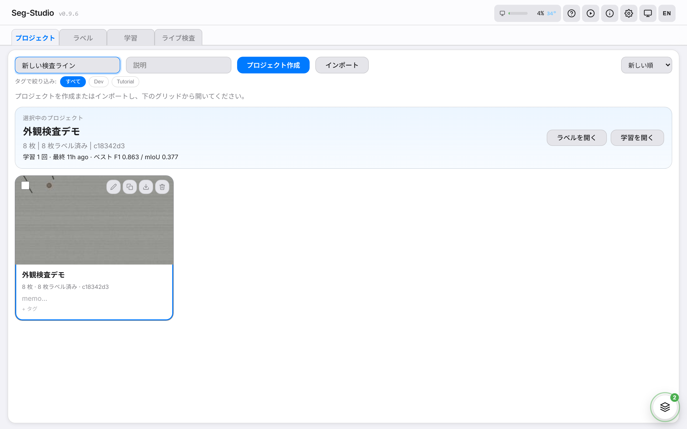
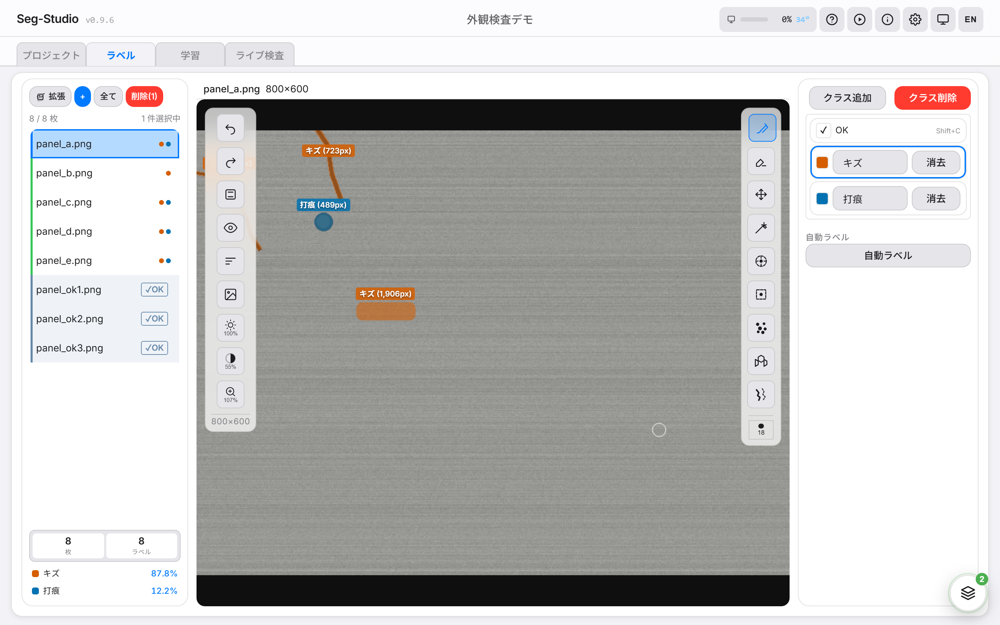
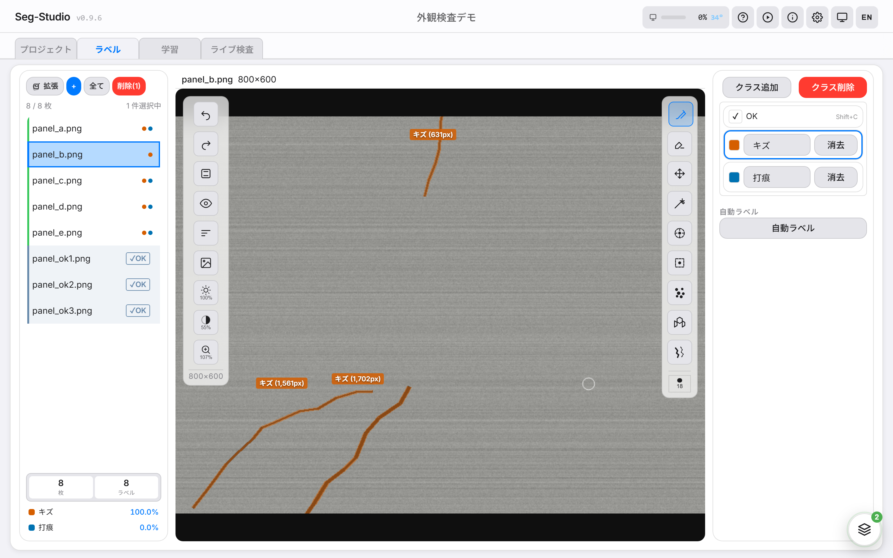
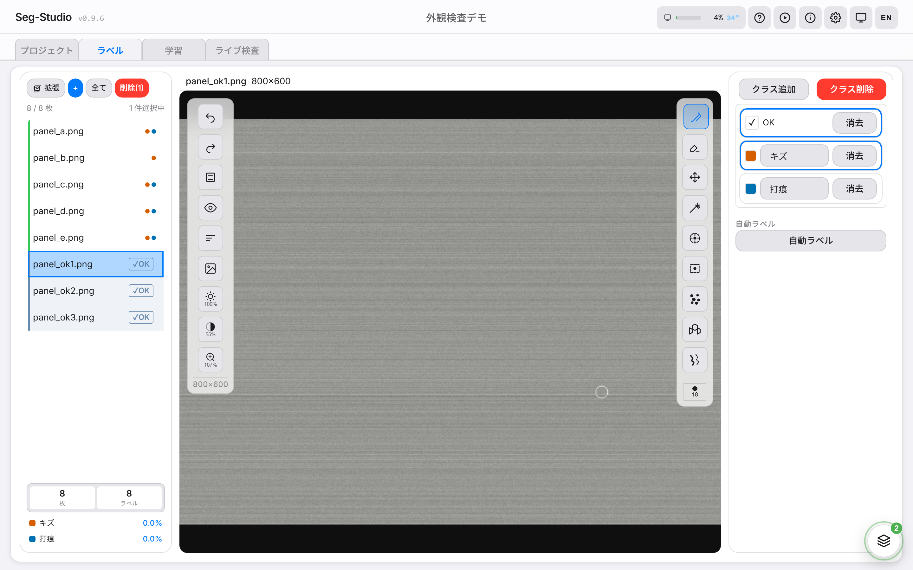
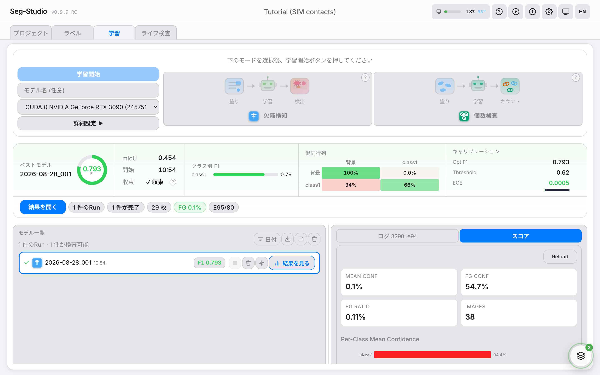
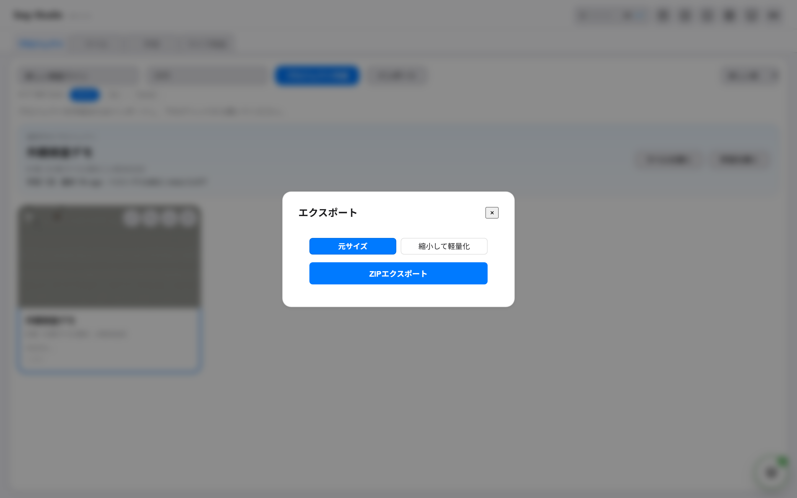

# Seg-Studio Handbook — Your First Run

> **Which document is this?** The long tutorial. It takes one sample set of
> images all the way through, in order: bring in images, mark the defects,
> train a model, save it as a file and use it. Advanced features are covered
> along the way. For the quickest route to a first result, use the
> [First Run Walkthrough](first-run-manual.md). To look up a single feature,
> use the [User Guide](user-guide.md). To install the app, see
> [Installation in detail](install.md).

This handbook is for people who have **never used Seg-Studio before**. You
do not need to program. It walks through the whole job in order:
add images → mark the defects → train → save the model → check new images.

It has 16 chapters and is meant to be read from start to finish, not looked
up like a reference. Chapters 1–13 are the main path you can do entirely on
screen. Chapter 14 is for engineers who want to call the model from a program.
Chapters 15 and 16 are an optional add-on about counting objects (16 is again
for engineers).

Words marked in the text are explained in the [Glossary](#glossary) at the end.

Rough budget:

- **⏱ Time**: 3–15 min per chapter
- **📸 Screenshots**: 7 so far — the rest are listed in `contributing/screenshots.md`
- **🎯 Goal**: End up with a working model and a Python client that calls it
  (the Python part is optional — chapter 14)

> 💡 The running example is an `Inspection demo` project that looks for two
> kinds of defect: scratch and dent. With your own images the steps are the same.

---

## Contents

1. [Welcome](#1-welcome) — What Seg-Studio does for you
2. [Start the app and find your way around](#2-start-the-app-and-find-your-way-around) — Opening it, and what each tab is for
3. [Create a project](#3-create-a-project) — One folder for one inspection job
4. [Add your images](#4-add-your-images) — Drag in photos, a video or a ZIP
5. [Decide what to find](#5-decide-what-to-find) — Name the kinds of defect (classes)
6. [Paint the defects](#6-paint-the-defects) — Brush, one-click outlining and other helpers
7. [Tell it which images are good](#7-tell-it-which-images-are-good) — Mark defect-free images as OK
8. [Make extra practice images](#8-make-extra-practice-images) — Generate new defects and new lighting automatically
9. [How images are set aside for checking](#9-how-images-are-set-aside-for-checking) — Happens by itself when you start training
10. [Choose training settings](#10-choose-training-settings) — Or simply take the suggested ones
11. [Train the model](#11-train-the-model) — Start it and watch it learn
12. [Look at the results](#12-look-at-the-results) — What it found and what it missed
13. [Save the model as a file](#13-save-the-model-as-a-file) — For other systems, apps and edge devices
14. [For engineers: call the model from Python](#14-for-engineers-call-the-model-from-python) — Optional
15. [Count objects](#15-count-objects) — How many screws or parts are in each image
16. [For engineers: get counts from another program](#16-for-engineers-get-counts-from-another-program) — Optional
- [Glossary](#glossary) — Plain explanations of the technical words

---

## 1. Welcome

Seg-Studio is an **all-in-one program for teaching a computer to find defects
in images, pixel by pixel** (this is called *segmentation*). In one place you
collect images, mark the defects, train a model, check how well it works, and
save it as a file (ONNX / CoreML) for use elsewhere. You do not need Python to
use it.

### Who it's for

- Anyone who wants to replace manual visual inspection with AI
- People who prefer clicking through screens to writing code
- Teams that need results they can use at work

### What it offers

- Runs entirely in a web browser
- Outline a defect with one click (SAM)
- Create new defect images by cut-and-paste (Perlin CutPaste)
- Re-colour images as day / evening / night for outdoor use (Lighting)
- Save a model that can keep learning on an iPhone / iPad (CoreML Updatable)
- Japanese screens (English switchable)


> **Tip**: The tabs go left to right in the order you work.
> If you get lost, go back one tab to the left.

---

## 2. Start the app and find your way around

### Start the app

If you installed it as described in [Installation in detail](install.md),
open **Seg-Studio**: from the Start menu or the desktop shortcut on Windows,
from `~/Applications` (or Spotlight) on macOS. Your web browser opens
`http://localhost:8002/ui/` by itself once the app is ready, and Seg-Studio
stays in the taskbar and the tray (Windows) or the Dock and the menu bar
(macOS). When you are done, close its taskbar button or quit it from the
Dock (**Stop and quit** in its menu does the same). `start-windows.bat` and
`bash start-macos.sh` in the Seg-Studio folder start it too.

<details><summary>More detail: other start scripts and restarting (for engineers)</summary>

The start scripts under `scripts/` also work:

```bash
# Windows
scripts\windows\start_local_windows.bat

# macOS
bash scripts/macos/start_local_macos.sh
```

The browser opens `http://localhost:8002/ui/` automatically once the API is ready.

On Windows, `restart-windows.bat` restarts the trainer API alone -- what a
settings change that "takes effect on next server restart" is waiting for. It
reuses the LAN token so browser sessions survive, detaches the new server so a
restart over SSH outlives the session, and refuses while training is running or
queued unless given `--force`.

</details>

### Tabs

| Tab | What you do there |
|---|---|
| **Projects** | See, create and switch projects |
| **Annotate** | Paint the defects on images |
| **Training** | Set up and run training |
| **Results tab** | Opens for a finished training run when you click **Results** on it; shows scores, heatmap, region counts (CCA) and Live Inspect views |
| **Live Inspect** | Connect a camera and check images in real time |

> **Tip**: The ⚙️ at the top right opens settings. The defaults are fine for most people.

---

## 3. Create a project

A project keeps everything for one inspection job — images, painted defects
and training results — together in one folder.

### Steps

1. Open the **Projects** tab
2. Type a name into the project-name field (e.g. `New inspection line`)
3. Click **Create Project**



### How projects are stored

- Each project gets a short ID code, and is stored under `projects/{id}/`
- **You can safely rename a project**; the ID does not change

> **Watch out**: Two projects can have the same name. They are still kept
> separate. Pick the one you want from the list to switch.

---

## 4. Add your images

### Option A: Drag & drop (recommended)

- **Annotate** tab → drop a folder onto the image list on the left
- Anything from 1 to several thousand files is fine
- Images are sent in batches sized to the files automatically

<details><summary>More detail: how uploads are grouped</summary>

Batch sizes are computed from each file's bytes — there is no setting to
tune. Places365 256px JPGs pack 100 per request; 4K photos pack 5 per request.

</details>

### Option B: Take still images from a video

- Drop a video file (`.mp4` etc.)
- Set "extract every N frames" (how often to take a still)
- The video is turned into images automatically

### Option C: ZIP import

For restoring a project you exported earlier.

---

## 5. Decide what to find

Here you decide which kinds of defect the model should find. Each kind is
called a **class**.

### Example (Inspection demo project)

| ID | Name |
|---:|---|
| 0 | background |
| 1 | scratch |
| 2 | dent |



### Guidelines

- **ID 0 must stay "background"** (everything that is not a defect). Don't change it
- Every extra class means much more painting work. **3–5 classes is the sweet spot**
- Merge defects that look alike. Splitting too finely hurts more than splitting too little

---

## 6. Paint the defects

Painting the defects on each image is called **annotation**. The painted
area is saved as a **mask** — a hidden layer that records, for every pixel,
which class it belongs to.

### 6-a. Brush basics



- **Brush** (`B`): drag to paint. `[` / `]` to change the size
- **Eraser** (`E`): paint over to remove

### 6-b. One-click outlining with SAM (main feature)

SAM (Segment Anything, a model made by Meta) comes built in.
**One click outlines the defect for you**.

#### How to use it

1. Select the **SAM** tool (`S`) in the tool column: a dashed circle with a
   dot at its centre
2. **Click** on the defect — every click is a point on the target; click a
   part it missed to add that part
3. If the outline is too coarse or too fine, pick another level of detail
   (**subpart** / **part** / **whole**)
4. Click inside the preview, or press Enter, to commit

#### Why it helps

- About 10 seconds to load the first time, then each click responds instantly
- Fine edges are picked up automatically → about 10× faster than brushing

### 6-c. Crack trace / Spot detect

- **Crack trace** (`C`): for line-shaped defects such as cracks. Click on one → possible paths are traced for you; click one to select it, Enter to commit
- **Spot detect** (`D`): finds small dot-like defects that look like one you painted. Paint one example, press **Detect**, adjust **Threshold** (1–60, higher finds fewer), Enter to commit

<details><summary>More detail: how Spot detect works</summary>

Spot detect uses Laplacian-of-Gaussian (LoG) blob detection.

</details>

### 6-d. Save / Undo

- `Ctrl+Z` / `Ctrl+Y` to undo / redo
- Your work is saved automatically when you switch tabs or move to another image
- `Ctrl+S` saves straight away

### 6-e. AI support panel (optional)

The **AI** button at the foot of the tool column opens the **AI support**
panel, where an AI image-reading model (a vision model) labels the project
for you while you watch. It needs a model server running on the PC that runs
Seg-Studio; with nothing set up, the panel looks for Ollama there:

1. Label a few images yourself first — the AI uses them as examples, and
   rehearses on up to three of them to choose how closely to look before it
   labels the rest
2. Type what to label and press **Start**
3. It asks once before it starts, with how long the run will take: press
   **Proceed** or **Stop** under the question, or answer in the same box and
   press **Answer**. If nobody answers for 20 minutes, the run ends without
   labelling
4. Watch the conversation and the images as they refresh. **Pause** /
   **Resume** and **Stop** take effect between steps, so nothing is left half-written

A run touches only this project, and never replaces a mask a person drew or
an image a person marked clean. The pictures it looks at, your instruction,
the project's name and the tool results are sent to the model server the
panel uses.

<details><summary>More detail: how it connects and how to set it up (for engineers)</summary>

The panel uses a vision model with tool calling, which works on the project
through the MCP bridge. Choosing the server and the model in the panel,
setting up a server on another machine (the `SEG_VLM_*` environment
variables or the `vlm` block of `projects/runtime_settings.json`) and every
control are covered in the [User Guide](user-guide.md#ai-support-panel). For
the MCP bridge and using your own AI client, see
[AI support and the MCP bridge](ai-support.md).

</details>

---

## 7. Tell it which images are good

Good images — ones with no defect — are **very important** for training.
They teach the model what "nothing wrong" looks like. Marking an image this
way is called Mark Clean, and the button for it is **OK**.

### What Mark Clean does

It gives the image an **empty mask (all background)** and flags it as "this is OK".
The model learns "nothing in this image is a defect."

### Steps

1. Select the good images in the list (Shift-click to select a range)
2. Click **OK** at the top (or press `Shift+C`)



### Example: outdoor use

Handheld cameras used outdoors see all kinds of backgrounds, so the model
often raises false alarms (calls something a defect when it isn't). To
counter this, add **ordinary indoor/outdoor scene photos** (e.g. the Places365
collection) and Mark Clean them all. The model learns "none of this is a defect."

> **Tip**: Keep Mark Clean images to **30–50% of the training images** at most.
> Too many makes the model miss more real defects (lower recall).

> **Watch out**: Images marked clean carry a **✓OK** badge in the image list.
> To undo Mark Clean, click **Clear Marks** next to OK, or the × on the badge.

---

## 8. Make extra practice images

Creating extra training images from the ones you have is called
**augmentation**. Seg-Studio has two ways to do it.

### 8-a. New defects by cut-and-paste (Perlin CutPaste)

Cuts a random defect out of an image you already painted, bends its shape a
little with a random pattern (Perlin noise), and pastes it somewhere else.

#### How

1. Annotate tab → **Augment** button
2. Check **Perlin CutPaste**
3. Pick the target class (or "All classes (mixed)")
4. Set how many images to make and how strongly to bend the shape (warp strength)
5. **Generate** — new images appear in seconds

### 8-b. Day / evening / night versions (Lighting, for outdoor use)

The same scene re-coloured as **daytime / evening / night**. The painted
defects stay exactly as they are; only the colours change.

#### How

1. In the Augment dialog, enable **Lighting variation** (time of day)
2. Pick any combination of day / evening / night
3. You can combine it with Perlin CutPaste in the same run

> **Tip**: Outdoor image sets are usually small. This one trick can
> triple the number of images you train on.

---

## 9. How images are set aside for checking

### What happens

Before training, your images are divided into three groups:

- **train** — the images the model learns from
- **val** (validation) — images held back to check progress during training
- **test** — images held back for a final check

The images are then copied into the layout that training reads.

### You don't need to do anything

There is no button. The split runs **automatically when you press Start
Train**. A "Preparing dataset..." line appears in the run list, followed by
how many images went to train and val.

To change the proportions (default val 15%, test 10%), open **⚙️ Settings**
at the top right and adjust **Validation Ratio** / **Test Ratio**.

### Good and defect images are split separately (important)

- **Images with defects** and **Mark Clean images** are divided separately
- So both kinds end up in val / test in the right proportion
- This prevents the failure where val holds only Mark Clean images and the score (F1) reads 0

> **Watch out — similar photos can end up on both sides.** The split does not
> know which photos belong together. Images are put in order by a code computed
> from the filename (its SHA1), which is effectively random with respect to
> shooting session, lot or workpiece. Burst shots of one part, or the same part
> shot from several angles, can therefore land in both train and val — and a
> near-identical photo in both makes the val score look better than the model
> really is. If your images come in such groups, set each image's
> **train / test** assignment yourself so a whole group stays on one side.
> The prepared `report.json` records how many you set by hand
> (`manual_train_count`, `manual_test_count`) alongside `split_grouping: "none"`.

<details><summary>More detail: how the training copies are stored (for engineers)</summary>

#### Prepared images are re-encoded as PNG (lossless in RGB)

Dataset preparation writes a training copy of every image into
`prepared/images/` as **PNG**. The copy is re-encoded, not copied: the source
is opened, converted to RGB and written out again, so the file is not
byte-identical to the original and an alpha channel is dropped. The RGB
values themselves survive intact, which is what "lossless" means here. The
prepared folder is correspondingly large.

One consequence worth knowing: if the file in `images/` is itself a JPEG --
and on installs that predate the import encoder some of them are, whatever
their names say -- then those pixels were already lossy before preparation
ran. `GET /api/v1/projects/{id}/layout/doctor` reports what your images
actually are, by their contents rather than their names.

**Trading fidelity for disk and decode speed.** JPEG quality 95 is available as
an opt-in, for projects where the prepared folder does not fit or where image
decoding is starving the GPU. Set:

```
SEG_PREPARED_IMAGE_FORMAT=jpeg
```

and re-run dataset preparation.

> **Deprecated.** This variable governs only the training copies under
> `prepared/images/`, which are on their way out. Set the storage format per
> project instead with `PUT /api/v1/projects/{id}/image-store` (the default
> for new projects is `PUT /api/v1/system/import-defaults`); that setting
> decides what every import route writes into `images/`, which is where the
> pixels will live.

Either way the copies are written as q95 JPEG with **4:4:4 chroma** (no colour
subsampling): several times smaller than PNG on large photographs, though more
bytes than the 4:2:0 encoder that used to be the default.

**What the JPEG option costs.** Quality 95 adds quantisation noise that is
spread evenly over the frame, inside defects and outside them alike, so it
does not erase defects selectively. But if your defects are one or two pixels wide, or very
low contrast, their signal-to-quantisation ratio is far worse — and **the
reported score will not tell you**, because training and evaluation both read
the re-encoded copies while inference reads your original files. Writing 4:4:4
is what keeps colour-only defects intact: at libjpeg's 4:2:0 default a one-pixel
colour line lost its contrast **16.25 → 5.21**, against 16.25 → 16.21 at 4:4:4.

The format in force is recorded in `prepared/report.json` as
`prepared_image_format`.

</details>

---

## 10. Choose training settings

### First, pick what kind of job this is

The Training tab starts with two mode cards — **Defect detection**
(paint masks, train, find defects) and **Count inspection** (count objects
from the masks you already painted — chapter 15).
**The Start Train button stays greyed out until you pick one.** For this
walkthrough, pick **Defect detection**.

### Take the suggested settings (Auto-config)

Seg-Studio looks at how many images you have, how big the defects are, and a
quick analysis of the images, and suggests settings for you: the model type
(`arch`), the size of the image pieces it learns from (`patch_size`) and the
model's width (`base_channels`). **When in doubt, take the suggestion.**

### Changing settings yourself (once you have a feel for it)

| Setting | What it means | Guide |
|---|---|---|
| arch | Model type | simpleunet (default, small and fast) / stdc (often more accurate, fastest when checking images) |
| patch_size | Size of the square pieces cut from each image for training | 256 (the default, and rarely worth changing) |
| output_stride | How finely the model draws edges | 2 or 4 (lower = finer edges) |
| epochs | How many times it goes through all training images | 80 (the default). Training stops early by itself when it stops improving (early stopping), and extends by itself if it is still improving when it reaches that number |



---

## 11. Train the model

### On your own computer

- Press **Start Train**. Training uses an NVIDIA graphics card (CUDA) when
  there is one; otherwise it uses Apple's graphics chip (MPS) or, much more
  slowly, the main processor (CPU). Only the counting mode (chapter 15)
  requires an NVIDIA card (CUDA).
- Progress shows as it learns: the **Models** list gives the epoch and the best F1 so far (a score, higher is better), and the **Logs** panel adds a line per epoch with its loss (falls as the model learns)
- A snapshot of the model (checkpoint) is saved automatically after each pass (epoch)

---

## 12. Look at the results

### Scores

- **F1**: the main score, from 0 to 1 — it balances "doesn't miss defects"
  against "doesn't raise false alarms". Compare it between training runs on the
  same images; there is no universal pass mark
- **mIoU**: how closely the outlines it draws match yours. If it is lower than
  F1, the edges are probably loose
- **Precision / Recall**: tell you which way it is wrong. Low precision = too
  many false alarms (FP); low recall = too many missed defects (FN)

### Ways to look at the results

| View | When to use it |
|---|---|
| **Heatmap** | A colour map of how sure the model is — see where it is confident and where it is borderline |
| **CCA (connected components)** | Counts the separate detected areas and shows how big they are |
| **Pattern overlay** | Show only the defects on top of the image |
| **Live Inspect** | Connect a camera and check images in real time |

### Adjust how sure it must be (threshold)

The slider on the right sets the **confidence threshold** — how sure the
model must be before it marks something as a defect. Move it and you
instantly see the trade-off between false alarms and missed defects.

---

## 13. Save the model as a file

Saving a trained model as a file that other software can use is called
**export**. Which format you need depends on where the model will run; if
someone else is building that system, ask them.

### Formats

| Format | Use for |
|---|---|
| **ONNX** | A widely supported format: running on a server, from Python/C++ programs |
| **CoreML** | Building into iPhone / iPad / Mac apps |
| **CoreML Updatable** | **Retraining on the iPhone / iPad itself** (iOS) |
| **OpenVINO** (FP32/FP16/INT8) | Running on Intel processors, built-in graphics or AI chips (CPU / iGPU / NPU) in small on-site devices |



### Steps

1. In the Training tab, pick a completed run and click **Results** to open its Result tab
2. Click **Export Model**, choose ONNX / CoreML / CoreML (Updatable), and confirm
3. Download the `.onnx` / `.mlmodel` file

> **OpenVINO is the exception**: export it from the OpenVINO menu on the run in
> the Training tab, which offers FP32 / FP16 / INT8.

> **Tip**: CoreML Updatable lets users fine-tune just the model's last layer
> (the final Conv layer) on the device — ideal for apps that adjust to each user.

---

## 14. For engineers: call the model from Python

> **This chapter is for people who use the model from a program.** If you only
> use the screens, you can skip it.

A Python client library (SDK), `seg-sdk`, ships with the app. It calls the
model over HTTP or WebSocket.

### Install

```bash
pip install ./packages/seg-sdk
```

### Minimal (5 lines)

```python
from seg_sdk import SegClient

client = SegClient("http://localhost:8002")
client.start_session(project_id="your-project-id", run_id="your-run-id")
result = client.predict(open("frame.jpg", "rb").read())
print(result.judgement, "| centroids:", [r.centroid for r in result.regions])
```

### What you get

| Field | Content |
|---|---|
| `judgement` | `"OK"` / `"NG"` |
| `regions[i].bbox` | Bounding box `(x, y, w, h)` |
| `regions[i].centroid` | Centroid `(cx, cy)` — great for robot pick |
| `summary.fg_ratio` | Fraction of pixels flagged as defect |
| `latency_ms.total` | Server processing time |

Full docs: [`packages/seg-sdk/README.md`](../packages/seg-sdk/README.md).

---

## 15. Count objects

Need to know **how many** screws / parts / tablets are in the image, even when
they touch or overlap? The counting mode (also called instance mode) trains a
counting model **from the masks you already painted** — you never have to mark
each object one by one.

### How it works

Your painted masks are cut into one piece per object, and practice images are
built from those pieces by copy-and-paste, so the right answer for every
object is known exactly. This includes pairs of objects touching end to end
(coaxial touching pairs) — the case counting models usually get wrong.
The check images (validation) are always original images that were never used
to build the practice images, and the counting threshold is tuned afterwards
on the exact model that gets exported.

**Every active class is counted.** You do not pick one — the model learns all
of them and reports a count per class.

<details><summary>More detail: the model used</summary>

The counting model is RF-DETR-Seg, trained from your semantic masks (the
ordinary painted masks from chapter 6) with exact per-instance ground truth
generated by the copy-paste synthesis.

</details>

### Steps

1. Paint the masks as usual (chapter 6). **Four images** containing
   the target class is the required minimum; more is better, and the
   preview strip below will tell you whether you have enough.
2. In **Training**, pick the **Count inspection** mode card.
3. If you want to adjust how the practice images are built (objects per image,
   how often touching pairs appear — stack-pair probability, and the size range
   of a single object — area band; `0` = automatic), open the **Settings**
   section in the Training tab (not the ⚙️ Settings window at the top right
   from chapter 9). Press **Generate** in the preview strip to check a few
   sample images.
4. Start training. **Small** is the default, **Medium** is noticeably more
   accurate, and **Large** can be chosen as a third size. If your graphics
   card has little memory (VRAM), Small and Medium adjust automatically — the
   batch halves and gradient accumulation doubles, so training still sees the
   same effective batch — with about 3.5 GB the minimum for Small.
   **Large has no measured memory table**, so it is not adjusted
   automatically: the run uses the batch you asked for unchecked and may run
   out of memory (OOM). If it does, lower the batch by hand.

   | Size | batch 8 | batch 4 | batch 2 |
   |------|---------|---------|---------|
   | Small | 8.0 GB | 5.5 GB | 3.5 GB |
   | Medium | 16.0 GB | 9.5 GB | 6.0 GB |

5. In **Results**, run the model on images. Each object is numbered on the
   image, and the header shows the count per class. **Detection highlight**
   switches to a view that greys the background and gives every object its own
   colour — the quickest way to see whether two touching parts were
   counted as one.
6. **Export → ONNX (Serving)** registers the model; once it is switched on
   (activated), `POST /count` on the serving API returns per-image counts (see chapter 16).

### Large images are cut into tiles automatically

**This needs nothing from you.** Large photos are checked in 768×768 pieces
(tiles) so that small objects are not shrunk away. Images smaller than 768 are
handled as one piece, just as before tiling existed.

<details><summary>More detail: why tiles, and how to change the tile size (for engineers)</summary>

The detector has a fixed input, so a whole photo has to be shrunk to reach it —
and a 110px screw in a 2560px frame arrives at about 16px, which is most of it gone.
So training composes **768×768 patches at capture resolution** and inference
runs the same 768 patches across the image, stitching the detections back
together.

The smaller the patch is next to the objects, the more of them a seam cuts,
and a cut object is where the count goes short; fewer, larger tiles are also
faster. That is why the default is 768.

Images smaller than 768 are handled as a single padded patch — exactly what
they did before tiling existed — so a project of 512px photos behaves as it
always has. Only larger frames tile.

If you do want to change it, `instance_patch_size` accepts a pixel size
(0-4096), or `0` to turn tiling off — the default 768 is already twice the
Small model's 384 input. Whatever you choose is recorded in the exported
contract, because **training and inference must use the same patch size** — a
mismatch does not raise, it just makes the count wrong.

</details>

### Known limits

- **Works best for separate, rigid parts** (screws, pins,
  stamped parts). Objects that bend a lot, or are piled tightly together, may
  need more real painted images. Watch the preview strip: if the sample images
  do not look like your real scenes, adjust the area band or paint more images.
- **There is a limit on how many objects one pass can report**, across all
  classes combined. On a model without tiles, once the count gets past 90% of
  that limit the result carries a warning instead of a confident number — split
  the image or crop more tightly. With the default tiles, each tile has its own limit.
- Objects **wider than the tile overlap** can be cut by a seam. At the default
  768 tile the overlap is 192px, so anything smaller than that is safe; larger
  objects need a larger tile.

<details><summary>More detail: the query budget (for engineers)</summary>

The limit is the model's **query budget**: how many instances one forward pass
can emit, across all classes combined. It is whatever the exported model
carries, not a fixed 200, and it bounds the whole frame only when tiling is off
(`instance_patch_size` 0) — with the default tiling every tile gets its own
budget. On a non-tiled model, past 90% of the budget the response carries a
truncation warning rather than a confident number.

</details>

---

## 16. For engineers: get counts from another program

> **This chapter is for people who connect the counting model to their own
> program.** If you only use the screens, you can skip it.

Once a counting model is activated in the serving registry, `POST /count` takes
one image and returns what it found. Runs on CPU; no GPU required.

```bash
curl -F "image=@tray.png" http://localhost:8001/count
```

```json
{
  "model_id": "b42d4695-...",
  "count": 40,
  "counts_by_class": {"1": 38, "2": 2},
  "class_names": {"1": "screw", "2": "washer"},
  "threshold": 0.3,
  "dedup_iou": 0.7,
  "image_size": [2560, 2048],
  "inference_time_sec": 0.52,
  "instances": [
    {
      "id": 1,
      "class_id": 1,
      "class_name": "screw",
      "conf": 0.9812,
      "bbox": [412, 233, 118, 121],
      "centroid": [470.4, 293.1],
      "area": 8842,
      "rle": {"size": [2048, 2560], "counts": []}
    }
  ]
}
```

| Field | Meaning |
|---|---|
| `count` | Total instances across every class |
| `counts_by_class` | Per class, keyed by the project's class id |
| `bbox` | `[x, y, width, height]` in original image pixels |
| `centroid` | **Area centroid** of the mask (first moment), not the box centre - this is the one to use for pick-and-place |
| `area` | Mask pixels |
| `rle` | COCO uncompressed RLE, column-major, the same encoding the trainer writes |
| `threshold`, `dedup_iou` | What the model was calibrated with, echoed so a caller can record it |

### When the count may be short

A detector can only emit as many detections per forward pass as it has queries,
shared across all classes. That budget is not fixed at 200 - serving reads it
from the activated model's export and reports whatever that model carries. Near
the ceiling the response gains:

```json
"truncation_warning": "191 instances is close to this model's per-image limit of 200; the real count may be higher",
"max_instances_per_image": 200
```

Treat that as "at least 191", not "191". Split the frame or crop tighter.

**Only whole-frame models produce this.** A patch-trained model - the default,
since `instance_patch_size` is 768 - tiles the image and gives each tile its own
query budget, so there is no per-frame ceiling to report and neither key is
returned. Train with `instance_patch_size` 0 if you want the whole-frame
behaviour these keys describe.

### When the threshold was never measured

The confidence threshold is chosen at training time by counting your annotated
validation photos at each candidate value. That needs at least one annotated
image in the validation split; without one the model ships the default instead,
and the response says so:

```json
"threshold_warning": "threshold 0.3 was not calibrated: the training run had no annotated validation image to measure against, so this is the default. Counts may be systematically high or low."
```

The usual cause is that every annotated image had a region outside the
single-object area band. Annotate one more image, keeping each object as its
own region, and retrain.

### Errors

| Status | Meaning |
|---|---|
| 503 | No model activated |
| 409 | The active model is a semantic-segmentation export - use `/segment` |

---

## That's it 🎉

You have gone all the way from raw images to a working model that other
programs can call. Next:

- Run the same steps on your own work images
- Skim the [catalog](catalog.md) for every other feature
- If false alarms are your main problem, add many varied good images and Mark Clean them
- To squeeze out the last few points of F1, stop relying on the suggested
  settings (Auto-config) and adjust them by hand

### Stuck?

- [Troubleshooting](troubleshooting.md)
- [Detailed user guide](user-guide.md)
- [Developer quickstart](dev-quickstart.md)

---

## Glossary

| Term | Meaning |
|---|---|
| **Annotation** | Painting the defects on images so the model knows what to look for |
| **Mask** | The saved result of annotation: an image that records, for each pixel, which class it belongs to |
| **Class** | One kind of thing to find (e.g. scratch, dent). ID 0 is always background |
| **Background** | Everything in the image that is not a defect |
| **Segmentation** | Deciding for every pixel which class it belongs to, rather than just drawing boxes |
| **SAM** | Segment Anything Model, a model by Meta that outlines an object from a click |
| **Mark Clean / OK image** | An image marked as having no defect; it gets an empty mask |
| **Augmentation** | Making extra training images from existing ones |
| **Perlin CutPaste** | Augmentation that cuts out a painted defect, bends its shape with a random pattern (Perlin noise) and pastes it elsewhere |
| **Lighting** | Augmentation that re-colours an image as day, evening or night |
| **train / val / test** | The three groups images are divided into: learn from / check during training / final check |
| **Training** | The model learning from your painted images |
| **Model** | The trained result that finds defects in new images |
| **Run** | One training session and its results |
| **Epoch** | One pass through all training images |
| **Checkpoint** | A saved snapshot of the model during training |
| **Early stopping** | Training stops by itself when the score stops improving |
| **Patch / patch_size** | A square piece cut out of a larger image; its size in pixels |
| **arch** | The model type (e.g. simpleunet, stdc) |
| **Auto-config** | The settings Seg-Studio suggests from your images |
| **Loss** | A number that falls as the model learns; lower is better |
| **F1** | Main score from 0 to 1 that balances missed defects against false alarms |
| **mIoU** | Score for how closely the drawn outlines match yours |
| **Precision / Recall** | Precision: how many detections were real defects. Recall: how many real defects were found |
| **FP / FN** | False positive (false alarm) / false negative (missed defect) |
| **Confidence threshold** | How sure the model must be before it marks something as a defect |
| **Heatmap** | A colour map of how sure the model is at each point |
| **CCA (connected component analysis)** | Counting the separate detected areas and their sizes |
| **Inference** | Running the trained model on images to find defects |
| **Export** | Saving the model as a file other software can use |
| **ONNX** | A widely supported model file format |
| **CoreML / CoreML Updatable** | Apple's model format / a version that can keep learning on the device |
| **OpenVINO** | Intel's format for running models on Intel processors; FP32/FP16/INT8 are its number-precision options |
| **GPU / CUDA / MPS / CPU** | Graphics card / NVIDIA's GPU system / Apple's GPU system / the main processor |
| **VRAM** | Memory on the graphics card |
| **OOM** | Out of memory: the job needed more memory than the card has |
| **Batch** | How many images are processed together in one step |
| **Instance mode** | The counting mode that tells individual objects apart |
| **Centroid** | The centre point of a detected area |
| **Bounding box (bbox)** | The rectangle around a detected area |
| **API** | A way for other programs to talk to Seg-Studio |
| **SDK** | A ready-made library for calling Seg-Studio from a program (here, Python) |
| **MCP bridge** | The connection AI assistants use to work on a project |

---

_Seg-Studio Handbook v1.0 — 2026-04_
