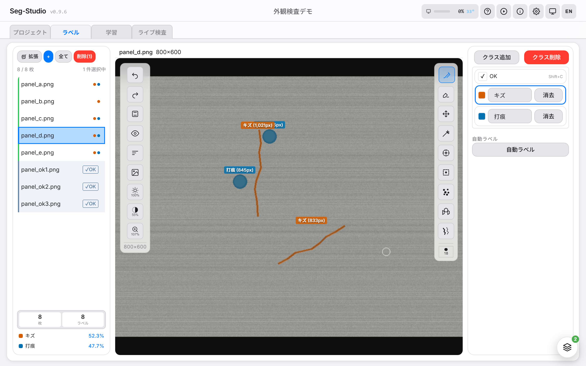
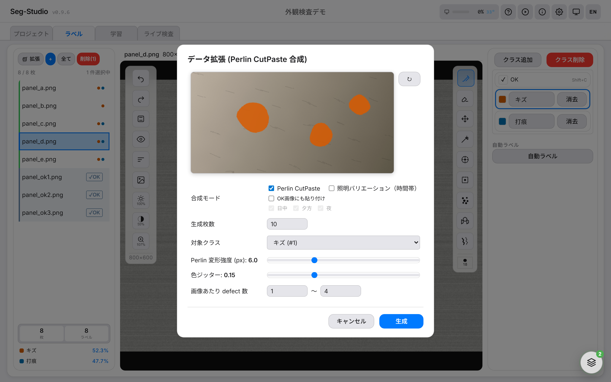
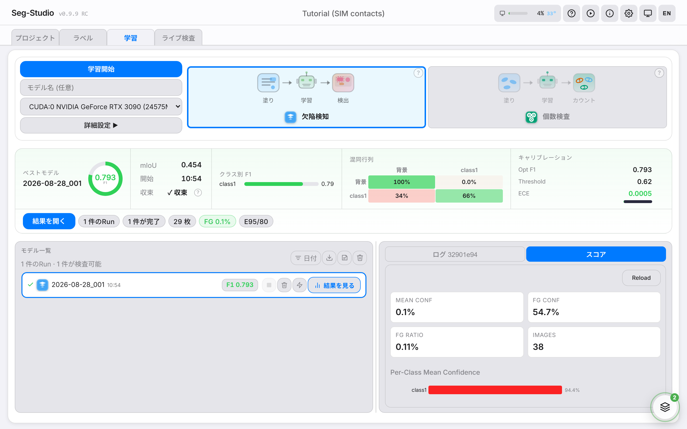
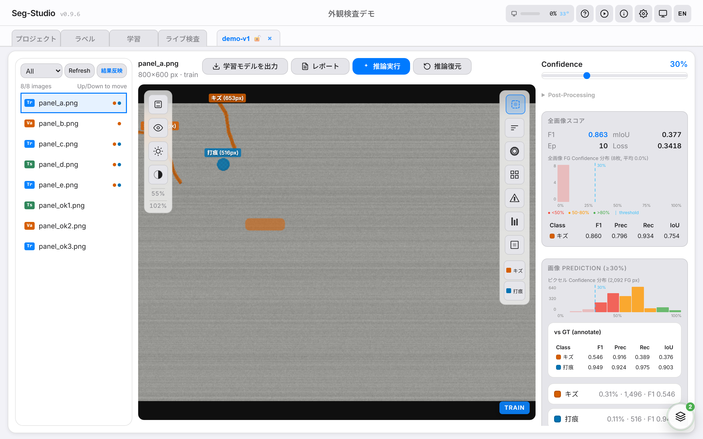
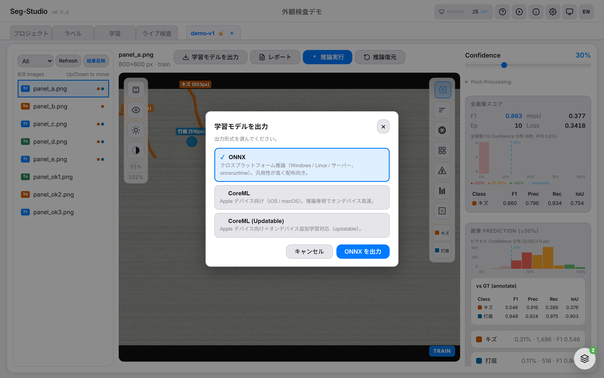

# Seg-Studio 機能カタログ

> **画像セグメンテーションをオールインワンで。** アノテーションからデータ拡張、学習、評価、配布まで、1つのツールで完結します。

---

## 🖊 アノテーション

| 機能 | できること | バッジ |
|---|---|:---:|
| ブラシ / 消しゴム / バケツ | 基本の描画ツール一式 | 標準 |
| 🆒 **SAM マーキング** | クリック1回で対象を自動で切り出す（Meta の SAM を内蔵） | 目玉 |
| ひび割れ検出 | クリックした亀裂を自動でトレースし、候補から選んで確定 | 便利 |
| スポット検出 | 塗った見本に似た点状の欠陥を検出（LoG によるブロブ検出） | 便利 |
| 矩形 | ドラッグした矩形を、選択中のクラスで塗りつぶす | 標準 |
| Move ツール | 既存のマスクをドラッグして移動 | 便利 |
| **OK（欠陥なし）** | OK 画像をワンクリックで学習データにする | 目玉 |
| AI サポートパネル | 視覚モデルが MCP ブリッジ経由でプロジェクトをラベル付けし、その様子を画面で確認できる（ご自身で動かすモデルサーバーが必要） | 便利 |

---

## 🧪 データ拡張

| 機能 | できること | バッジ |
|---|---|:---:|
| 🆒 **Perlin CutPaste 合成** | 既存の欠陥を変形させて、ランダムな位置に貼り付ける | 目玉 |
| 🆒 **Lighting バリエーション** | 日中 / 夕方 / 夜の色調に変換し、屋外の撮影条件に対応 | 目玉 |
| Auto-config | データの特性から最適な設定を自動で推薦 | 便利 |
| Annotation Patches | 重心を基準にした効率的なパッチサンプリング | 標準 |

---

## 🎓 学習

| 機能 | できること | バッジ |
|---|---|:---:|
| 学習モード | 欠陥検知 / 個数検査（インスタンス）を選んで開始 | 標準 |
| 🆒 **個数カウント** | 画像1枚あたりの部品数を数える。描き済みのセグメンテーションマスクから学習 | 目玉 |
| タイル学習・推論 | 小さな物体を撮影時の解像度のまま扱う（縮小で潰れない） | 便利 |
| ローカル GPU 学習 | 手元の PC でそのまま学習 | 標準 |
| 🆒 **DINOv2 特徴蒸留** | 142M 枚の画像で学習した教師モデルから特徴を蒸留 | 目玉 |
| Lovász-Softmax Loss | 境界に強い損失関数を選択可能 | 便利 |
| 多様なアーキテクチャ | SimpleUNet / STDC | 標準 |
| Deep Supervision | 補助損失で中間層も学習 | 標準 |

> 異常検知（OK 画像だけからの学習）は、Seg-Studio の対象外としました。姉妹プロジェクトの [**Cls-Studio**](https://github.com/segmen-pixel/cls-studio)（産業向けの良否判定）が担当します。

---

## 📊 評価・可視化

| 機能 | できること | バッジ |
|---|---|:---:|
| メトリクス一覧 | F1 / mIoU / Precision / Recall | 標準 |
| ヒートマップ | 確信度を色で表示 | 便利 |
| **CCA 分析** | 検出領域の数とサイズの分布 | 便利 |
| **Pattern Overlay** | 欠陥だけを取り出して元の画像に重ねる | 便利 |
| 🆒 **ライブ検査** | カメラ映像をリアルタイムで推論 | 目玉 |
| しきい値スライダー | 確信度のしきい値をその場で変更 | 便利 |
| Batch Export | 全画像の推論結果を一括で書き出し | 便利 |

---

## 📦 配布・エクスポート

| 機能 | できること | バッジ |
|---|---|:---:|
| ONNX エクスポート | Python / C++ のサーバーでの推論向け | 標準 |
| CoreML エクスポート | iOS / macOS アプリへの組み込み向け | 標準 |
| 🆒 **CoreML Updatable** | iOS 上でオンデバイス再学習が可能 | 目玉 |
| OpenVINO エクスポート | FP32 / FP16 / INT8。Intel の CPU / iGPU / NPU 向け | 便利 |
| Python SDK | `pip install` ですぐに使える | 標準 |
| REST API | `/v2/infer` で1枚ずつ推論 | 標準 |
| カウント API | `/count` がクラス別の個数と、個体ごとの矩形を返す | 便利 |
| 🆒 **WebSocket 推論** | 連続するフレームを低遅延でストリーミング推論 | 目玉 |

---

## 🔧 UX / 運用

| 機能 | できること | バッジ |
|---|---|:---:|
| 日本語 UI | すべて日本語化済み（英語にも切り替え可能） | 標準 |
| 大きな画像のタイル表示 | 8K の画像も快適に閲覧（DZI） | 便利 |
| 複数プロジェクトの管理 | ダッシュボードで一覧・切り替え | 標準 |
| 動的バッチアップロード | ファイルサイズに応じてバッチを最適化 | 便利 |
| ハンズオンチュートリアル | 画面上で操作を案内 | 便利 |

---

## アイコン凡例

| バッジ | 意味 |
|:---:|---|
| 目玉 | Seg-Studio ならではの機能 |
| 便利 | 作業効率を上げる機能 |
| 標準 | 業界で標準的な機能 |
| 🆒 | 特に見てほしい目玉機能 |

---

## 資料リンク

- 🚀 [はじめてのファーストラン手順](first-run-manual.md)：最初の推論結果までの最短手順
- 📘 [はじめてのハンドブック](handbook.md)：全16章を通して学ぶチュートリアル
- 📖 [ユーザーガイド（詳細版）](user-guide.md)：機能のリファレンス
- 🛠 [トラブルシュート](troubleshooting.md)
- 💻 [開発者向けクイックスタート](dev-quickstart.md)

---

_Seg-Studio Catalog_
