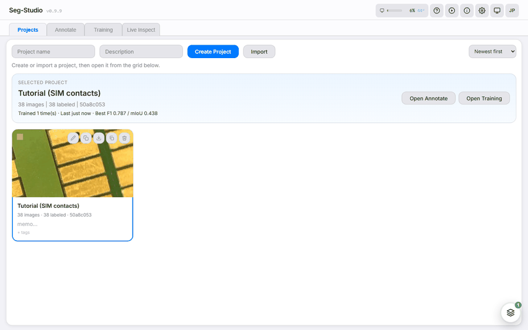

# Seg-Studio

**無料で使える画像解析 AI ソフト。写真の中のキズ・汚れ・異物を見つける AI を、自分のパソコンで作れます。**

Seg-Studio は、画像を AI で解析するための無料のソフト（フリーソフト）です。写真の上で「ここがキズ」「ここが汚れ」と塗って教えると、AI がそれを覚え、新しい写真から同じものを自動で見つけて色を付けます。画像認識の AI を、プログラミングなしで作れます。操作はすべて画面の上で行います。

- **無料で使えます。** オープンソース（Apache-2.0）で、仕事にも使えます。
- **画像は外に出ません。** すべて手元のパソコンの中で動き、クラウドのアカウントも要りません。
- **Windows と Mac で動きます。** GPU（グラフィックボード）があると学習が速くなりますが、なくても使えます。

## こんなときに

- 製品の写真から、キズ・汚れ・欠け・異物を AI で見つけたい（**外観検査**、不良品の**欠陥検出**）
- 写真に写った部品や細胞の数を数えたい（**個数カウント**）
- AI による画像検査を、まず費用をかけずに試してみたい
- 画像を社外やクラウドに出せない
- 塗り分けの作業（**アノテーション**）だけに使いたい（**アノテーションツール**として）

## 使い方の流れ

1. **塗る** — 写真を読み込み、見つけたいところを塗ります。クリック 1 つで形を切り出す補助（SAM）も使えます。
2. **学習させる** — 塗った写真から AI を作ります。細かい設定は自動で決まるので、ボタンを押して待つだけです。
3. **確かめる** — 新しい写真で試し、何を見つけて何を見逃したかを画像で確かめます。
4. **書き出す** — 作った AI を、ほかのソフトや iPhone / iPad でも使える形式で書き出せます。

どこまで見つけられるかは、写真の撮り方や教える枚数によって変わります。現在は beta 版です。

現在のリリース：**v0.9.13（beta）** · Apache-2.0 · [ダウンロード](https://github.com/segmen-pixel/seg-studio/releases/latest) · [ソース](https://github.com/segmen-pixel/seg-studio) · [English](../)

## 専門用語でいうと

Seg-Studio は、セマンティックセグメンテーションのためのオールインワンの GUI ツールです。Windows と macOS でローカルのアプリとして動き、SAM を使ったアノテーション、PyTorch によるモデルの学習、ONNX と CoreML へのエクスポートまでを1つの画面で行えます。クラウドのアカウントも画像のアップロードも要らず、データと学習済みモデルは実行したマシンから出ません。

セグメンテーションに加えて、**アノテーション済みのマスクを使った個数カウント**にも対応しています。カウントのためにアノテーションをやり直す必要はありません。

## どこから読むか

| 目的 | ページ |
|---|---|
| はじめて使う | [はじめての手順](../docs/ja/first-run-manual.md) — アプリを開いてから最初の推論結果まで約10分 |
| 機能を1つ調べたい | [ユーザーガイド](../docs/ja/user-guide.md) — 各タブ・ツール・設定の説明 |
| ひと通り理解したい | [ハンドブック](../docs/ja/handbook.md) — サンプルデータで最初から最後まで、全16章 |
| Linux、Docker、オフライン環境に入れたい | [インストールの詳細](../docs/ja/install.md) |
| インストールでつまずいた | [トラブルシューティング](../docs/ja/troubleshooting.md) |
| AI モデルにラベル付けを任せたい | [AI サポート](../docs/ja/ai-support.md) — [Ollama での手順例](../docs/ja/ai-support-ollama.md)もあります |
| 共有マシンや LAN で使う | [デプロイガイド](../docs/ja/deployment.md) |
| 開発に参加したい | [開発者向けクイックスタート](../docs/ja/dev-quickstart.md) |

## 主な機能

- **SAM を使ったアノテーション** — クリックでの領域の切り出し、ブラシ、矩形、クラスの管理、自動保存。マスクはインデックス付きの PNG なので、ほかのツールにも持ち出せます。
- **コードを書かない学習** — タスクを選ぶと、バックボーン、エポック数、データ拡張、学習率がレシピとして自動で決まります。どの項目も、あとから手で変えられます。
- **学習中の確認と評価** — 学習中はエポックとそこまでの最高 F1 を表示し、終わったあとは画像ごとの F1・適合率・再現率・IoU、確信度の分布、ヒートマップで、モデルが何を学んだかを確かめられます。
- **個数カウント** — 既存のマスクから物体の個数を数えます。
- **エクスポート** — ONNX、OpenVINO IR、CoreML。エッジデバイス、iPhone、Seg-Studio を入れていない PC でも推論できます。
- **オフラインで動作** — クラウドのアカウント不要、テレメトリなし、画像を外部に送りません。

機能の一覧は[機能カタログ](../docs/ja/catalog.md)、実測値は[ベンチマーク](../BENCHMARKS.md)にあります。

## インストール

ZIP をダウンロードして `install` を実行し、スタートメニュー（macOS では `~/Applications`）の **Seg-Studio** を開きます。ブラウザに `http://localhost:8002/ui/` の画面が開きます。Windows と macOS それぞれのコマンドは [README（日本語）](../README.ja.md)に、そこから学習までの流れは[はじめての手順](../docs/ja/first-run-manual.md)にあります。

Python 3.11 以降が必要です。CUDA の GPU があれば学習はかなり速くなりますが、必須ではありません。CPU でも学習でき、Apple Silicon は MPS で動きます。

## よくある質問

### 無料ですか。仕事でも使えますか。

はい。オープンソース（Apache-2.0）なので費用はかからず、仕事にも使えます。

### プログラミングの知識は要りますか。

ラベル付け・学習・確認の操作には要りません。インストールには Python 3.11 以降が必要で、手順は [README（日本語）](../README.ja.md)にあります。

### 画像がインターネットに送られることはありますか。

ありません。すべて手元のパソコンの中で動き、利用状況の送信（テレメトリ）もありません。

### 高性能なパソコンが必要ですか。

CUDA の GPU があれば学習はかなり速くなりますが、必須ではありません。CPU でも学習でき、Apple Silicon の Mac は MPS で動きます。

## リファレンス

- [インポート / エクスポートの形式](../docs/ja/import_export.md)
- [ロードマップ](../docs/ja/ROADMAP.md) · [変更履歴](../CHANGELOG.md) · [セキュリティポリシー](../SECURITY.md)

## ライセンス

Apache-2.0 です。同梱しているサードパーティのコンポーネントとそのライセンスは、[THIRD_PARTY_NOTICES](https://github.com/segmen-pixel/seg-studio/blob/main/THIRD_PARTY_NOTICES.md) に記載しています。
